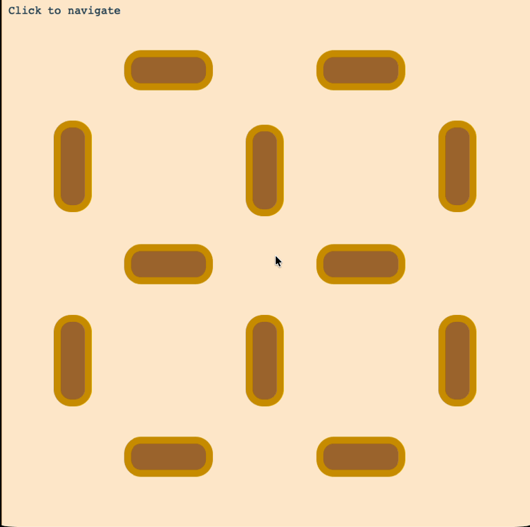

# Phaser 4 - Nav-Mesh


**Phaser Version:** `4.1.0`


A how-to or base template for Phaser 4 games that need a nav mesh.



## Requirements

This template is intended to work without additional baggage of an NPM project. No more wall of red error messages about
out of date packages and security problems, no more installing the whole internet. 

You just need:

- A modern web browser
- A local web server (it comes with a basic one)

### Pre-requisites

- Editor - Try [VS Code]
- Command line (VS Code has one: see the _Terminal_ menu)
- [Node.JS](https://nodejs.org/en/download)

## Setup

Follow these command line instructions:

```shell
# Get this project from GitHub
git clone git@github.com:sarah-j-smith/nav-mesh-phaser.git
```

Or [download the zip file](https://github.com/sarah-j-smith/nav-mesh-phaser/archive/refs/heads/main.zip).

```shell
# Download and install nvm, if you don't have it
curl -o- https://raw.githubusercontent.com/nvm-sh/nvm/v0.40.8/install.sh | bash

# If you installed nvm start a new shell, or do this instead of restarting the shell
\. "$HOME/.nvm/nvm.sh"

# change into the checked out template
cd nav-mesh-phaser 

# Download and install Node.js - this reads the nvmrc file to get the right version
nvm use

# Verify the Node.js version:
node -v # Should print "v24.21.0".
```

Or download [Node.JS](https://nodejs.org/en/download) with an installer.

## Newbie?

* Use a Node installer and VS Code - here's a tutorial on YouTube:

https://youtu.be/ZvzJ_vD4YUw?si=wyH-0i9_dh1o93Et

In [VS Code] choose _File > Open_ at the root folder of this project, then open a terminal with the Terminal menu.

[VS Code]: https://code.visualstudio.com/download?_exp_download=d53503e735

## Running Locally

```bash
# Uses a very basic node:http web server script to serve the project
node src/server.js .
```

You can also use the [Live Server](https://marketplace.visualstudio.com/items?itemName=ritwickdey.LiveServer) VS Code extension.


## Tiled Object Layers

Follow this to create a nav mesh from a [Tiled object layer]:

* https://github.com/mikewesthad/navmesh/blob/master/tiled-navmesh-guide.md

[Tiled object layer]: https://docs.phaser.io/api-documentation/class/tilemaps-tilemap#createfromobjects

## Deploying or Updating

* See [the original template docs](./doc/Deploying-and-Updating.md).

## Credits

* [Javascript Astar] and [NavMesh] by Mike Westhad 

[Javascript Astar]: https://github.com/mikewesthad/javascript-astar
[NavMesh]: https://github.com/mikewesthad/navmesh/tree/master


* Phaser 4 project template by [Scott Westover / Dev Share Academy.](https://github.com/devshareacademy/phaser-4-basic-js-template)

> A barebones, command line-oriented template for [Phaser 4](https://github.com/photonstorm/phaser) using JavaScript & Node.
